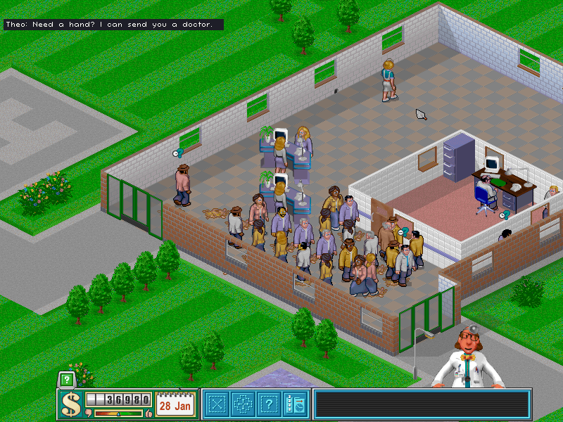
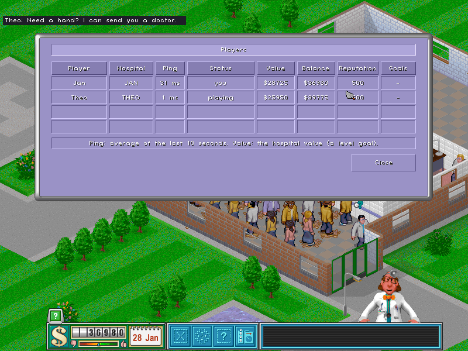

<picture></picture>

# CorsixTH Multiplayer

   

**Network multiplayer for [CorsixTH](https://github.com/CorsixTH/CorsixTH)**, the open-source reimplementation of Bullfrog's 1997 business sim Theme Hospital. Play with friends over the internet: in **one shared hospital**, or **each in your own hospital as a team** on the original multiplayer maps. Windows, Linux and macOS players play together.

This is a fork of CorsixTH, not an official CorsixTH release. Single player works exactly as in CorsixTH.

<picture></picture>

## Getting Started ##

1. **Download the game** for your system from the [latest release](https://github.com/lbakyl/CorsixTH-Multiplayer/releases/latest):
   - **Windows** (64-bit): unzip `...-win64.zip` and start `CorsixTH.exe`.
   - **Linux** (x86_64, Ubuntu 24.04, Linux Mint 22 or newer): unpack `...-linux-x86_64.tar.gz` and start `CorsixTH-Multiplayer/CorsixTH-Multiplayer.sh`.
   - **macOS** (Apple Silicon, macOS 26 Tahoe or newer): unzip `...-macos-arm64.zip` and move `CorsixTH.app` to Applications. The app is not notarized by Apple: the first time, open **System Settings > Privacy & Security** and click **Open Anyway**.
2. **Theme Hospital's game data** is needed, as for CorsixTH: the original CD, or a download from [GOG.com](https://www.gog.com/game/theme_hospital) or [EA](https://www.ea.com/games/theme/theme-hospital). The first start asks for its folder.
3. **Main menu > Multiplayer**: enter the server address `eu1.bachelor-tech.com:47800` (it runs the newest stable release; `eu2.bachelor-tech.com:47800` runs the newest test build) and your name, then **Connect**.
4. **Create a room** (one shared hospital, or a hospital each; the level; how many players; a password if you like) or **join** one. When everybody is ready, the room's owner starts the game. The lobby measures everybody's connection and sets the top speed that stays smooth.
5. Everybody in a game must run the **same release**. A server only lets in the release it runs, and tells you which one to download.

The full guide, with co-op, trading, saving and what to do if something goes wrong: [docs/multiplayer/PLAYING.md](docs/multiplayer/PLAYING.md). To run your own server with the referee, like eu1 and eu2: [docs/multiplayer/SERVER-SETUP.md](docs/multiplayer/SERVER-SETUP.md).

### What's Working? ###
The whole single player game of CorsixTH (you can complete the full campaign), and multiplayer for two to four players.

##### Multiplayer #####
- **One shared hospital:** everybody builds, hires and manages the same hospital; single player rules for winning and losing.
- **A hospital each (co-op):** the original two- to four-player maps, each player running their own hospital, as a team: the level is won when every hospital has reached its goals, and lost if one keeps failing them.
- **Trading between hospitals:** send money or ask for it, offer staff (free or for a price, also from the staff window), refer patients, share research (free or for a price).
- **Smooth at every speed:** a click takes effect in about a tenth of a second, Slowest and pause included.
- **Shared speed:** pause and unpause are instant for everybody; a new speed is put to a vote and needs more than half of the players.
- **Nobody waits for another player's windows:** faxes, pay rises, questions and the annual report do not pause the game.
- **In-game chat**, to everybody or one player, and a players window (MULTIPLAYER > PLAYERS) with ping, money, value and each hospital's goals.
- **Saving and continuing** a multiplayer game from the lobby (File > Save and a monthly autosave).
- **Self-repairing games:** the server runs its own copy of every game; if the players' games ever differ, everybody quietly loads the server's copy and plays on. A player who drops out can rejoin.

<picture></picture>

##### Original Features (from CorsixTH) #####
- Single player campaign
- All diseases, objects, rooms are available
- All events (emergencies, earthquakes, epidemics, VIP visits)
- Management windows (managing staff, patients, policies etc.)
- Music/Jukebox
- Gameplay videos
- Cheats (naughty!), in single player

### New Features ###
##### In this fork #####
- Network multiplayer, shared and co-op, through a small relay server ([run your own](docs/multiplayer/vps-guide.md))
- Builds for Windows, Linux and macOS (Apple Silicon) that play together
- Votes on the game speed, trades with prices, chat, a players window
- A headless referee on the server that repairs games and lets players rejoin

##### From CorsixTH #####
- Custom levels and campaigns
- Full HD and 4K support
- Zooming
- UI scaling
- Subtitles
- More than 20 different languages (multiplayer games are played in English for now)
- Make your own maps and levels with built-in map editor
- Unlimited save files
- Play your own music!
- Option to build rooms while paused
- Option to remove destroyed rooms for a fee
- Improved game logic
- Full control over all hotkeys
- Machine menu
- Adviser messages history

### What's missing/needs improvement? ###
##### Multiplayer #####
- Competitive games (hospitals playing against each other)
- Encryption: connections and room passwords are not encrypted, so do not use a password you use elsewhere
- Other game languages in multiplayer (everybody plays in English)
- A notarized macOS app, and builds for Intel Macs and 32-bit systems
- Now and then the players' games still go out of sync; the server repairs this within a second

##### From CorsixTH #####
- AI Hospitals (and the components associated with it)
- Rats (but rat holes are present) and the bonus rat level
- Vomit waves
- Win level video/letter
- The original graphics do not have a complete set for Pregnancy, Alien DNA, and female Fractured Bones patients -- these may cause anomalies if you enable regular spawning in settings
- Some objects in the game may glitch with walls

## Multiplayer development

How it works (deterministic lockstep, the relay server, the referee), the tests and the lessons learned: [docs/multiplayer/README.md](docs/multiplayer/README.md), with [protocol.md](docs/multiplayer/protocol.md), [referee.md](docs/multiplayer/referee.md) and [coop-architecture.md](docs/multiplayer/coop-architecture.md). Work in progress lives on `mp/*` branches until it is tested and moved to `master`. Problems with multiplayer: please [open an issue on this fork](https://github.com/lbakyl/CorsixTH-Multiplayer/issues/new) (server, room name, time, what you were doing).

----

*The rest of this page is from upstream CorsixTH: the project this fork is built on, its community and how to help it.*

## Developers
### Coders and non-coders we want you!

We are always looking for help with improving CorsixTH. The code base is made up of Lua and C++. Most of the game logic is written in Lua, we love Lua and its approachable and easy to pick up nature, so hit fork and get started! But don't worry if you don't code as we can always use your help in other areas and if you have ideas for the project please contact us or open a new issue! We could also use help updating the documentation in the wiki and keeping the issue list up to date.\
You can also [click here](https://github.com/CorsixTH/CorsixTH/issues?q=is%3Aissue+is%3Aopen+label%3A%22Good+First+Issue%22) to find issues that would suit a first-time contributor to take on!

###### Features & Bugfixes ######
We still have features to add and bugs to fix, check out the issue tracker [here](https://github.com/CorsixTH/CorsixTH/issues). Want to talk about adding a feature? post on our Google group or [contact us](#Contact).

###### Translation ######
CorsixTH has translations for more than 20 different languages, some of which need updating. Read our [wiki](https://github.com/CorsixTH/CorsixTH/wiki/Localization) for more information.

## More

Our [wiki](https://github.com/CorsixTH/CorsixTH/wiki) is a good place to start, if you can't find what you are looking for feel free to contact us using one of the methods below.

## Contact

- Follow us on [Reddit](https://www.reddit.com/r/corsixth), Twitter/X ([**@CorsixTH**](https://twitter.com/CorsixTH)), and on [Facebook](https://facebook.com/CorsixTH)
- 

  
Hit us up on Matrix! (Discord bridged) [click to expand]

  
  - **CorsixTH Space** (includes all rooms below, if your client supports it) [#CorsixTH:matrix.org](https://matrix.to/#/#CorsixTH:matrix.org)
  - **General Chat** [#corsixth-general:matrix.org](https://matrix.to/#/#corsixth-general:matrix.org)
  - **Announcements** [#corsixth-announcements:matrix.org](https://matrix.to/#/#corsixth-announcements:matrix.org)
  - **Technical Discussion** (DevOps) [#corsixth-technical:matrix.org](https://matrix.to/#/#corsixth-technical:matrix.org)
  - **Help!** [#corsixth-help:matrix.org](https://matrix.to/#/#corsixth-help:matrix.org)
  - **Community Content** [#corsixth-usercontent:matrix.org](https://matrix.to/#/#corsixth-usercontent:matrix.org)
  

- Join the server on [Discord](https://discord.gg/Mxeztvh)
- Subscribe to our [Google Developer group](https://groups.google.com/g/corsix-th-dev)
