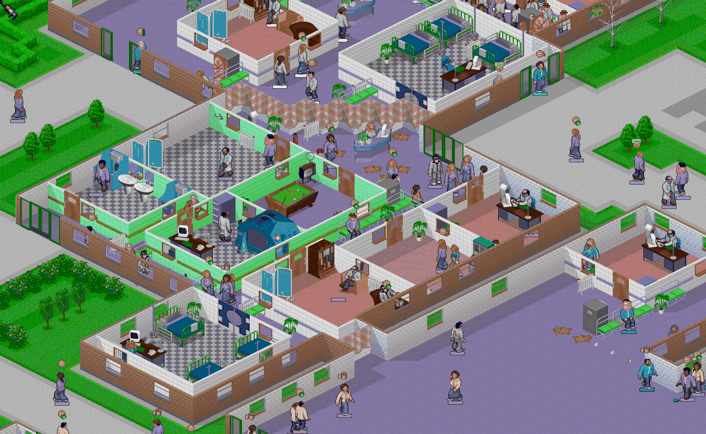
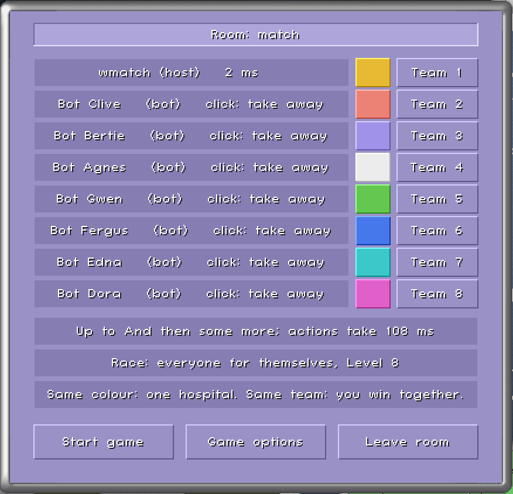
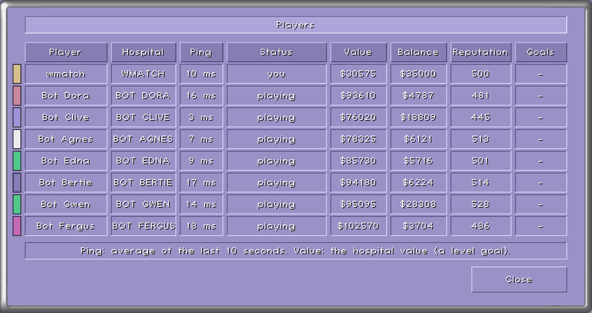
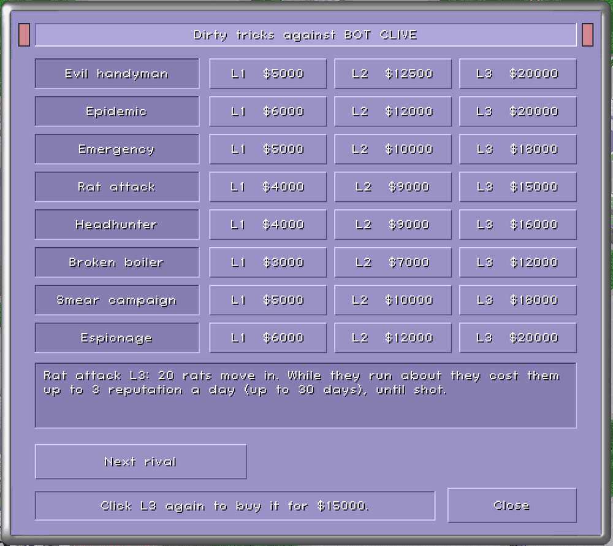
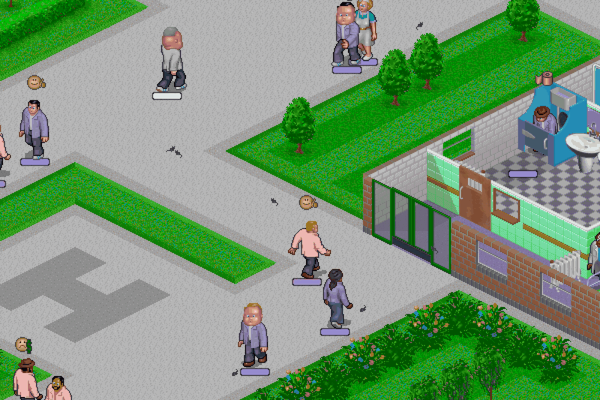
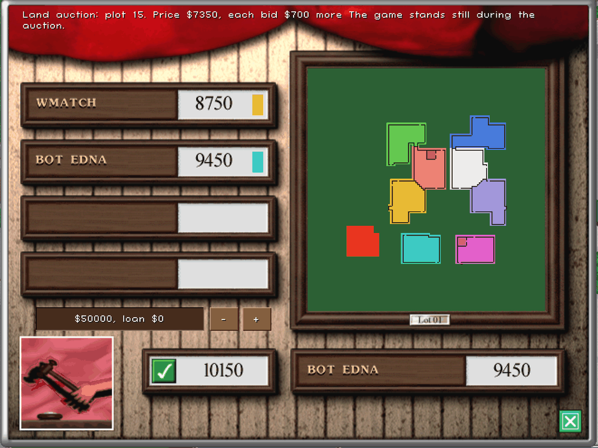
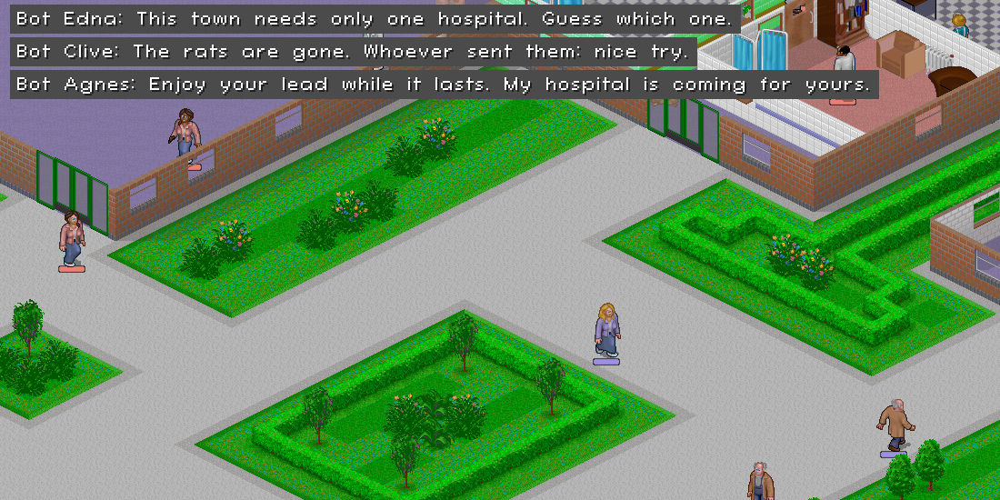

<picture></picture>

# CorsixTH Multiplayer

   

**Network multiplayer for [CorsixTH](https://github.com/CorsixTH/CorsixTH)**, the open-source reimplementation of Bullfrog's 1997 business sim Theme Hospital. Play with friends over the internet, **up to 8 players**: in **one shared hospital**, **each in your own hospital as a team**, or **in a race against each other** with dirty tricks, land auctions and computer players (bots) for the empty places. Windows, Linux and macOS players play together, each in their own game language.

This is a fork of CorsixTH, not an official CorsixTH release. Single player works exactly as in CorsixTH.

<picture></picture>

## Getting Started ##

1. **Download the game** for your system from the [latest release](https://github.com/lbakyl/CorsixTH-Multiplayer/releases/latest):
   - **Windows** (64-bit): unzip `...-win64.zip` and start `CorsixTH.exe`.
   - **Linux** (x86_64, Ubuntu 24.04, Linux Mint 22 or newer): unpack `...-linux-x86_64.tar.gz` and start `CorsixTH-Multiplayer/CorsixTH-Multiplayer.sh`.
   - **macOS** (Apple Silicon, the macOS version the release names, usually 27 or newer): unzip `...-macos-arm64.zip` and move `CorsixTH.app` to Applications. The app is not notarized by Apple: the first time, open **System Settings > Privacy & Security** and click **Open Anyway**.
2. **Theme Hospital's game data** is needed, as for CorsixTH: the original CD, or a download from [GOG.com](https://www.gog.com/game/theme_hospital) or [EA](https://www.ea.com/games/theme/theme-hospital). The first start asks for its folder.
3. **Main menu > Multiplayer**: click **EU1: stable** (`eu1.bachelor-tech.com:47800`, the newest stable release) or **EU2: test builds** (`eu2.bachelor-tech.com:47800`, the newest test build), enter your name, then **Connect**.
4. **Create a room** (the level, how many places, a password if you like) or **join** one. Everybody picks a colour and a team: the same colour shares a hospital, the same team wins together. Click an empty place to add a bot. When everybody is ready, the room's owner starts the game. The lobby measures everybody's connection and sets the top speed that stays smooth.
5. Everybody in a game must run the **same release**. A server only lets in the release it runs, and tells you which one to download.

The full guide, with co-op, races, trading, saving and what to do if something goes wrong: [docs/multiplayer/PLAYING.md](docs/multiplayer/PLAYING.md). To run your own server with the referee, like eu1 and eu2: [docs/multiplayer/SERVER-SETUP.md](docs/multiplayer/SERVER-SETUP.md).

### What's Working? ###
The whole single player game of CorsixTH (you can complete the full campaign), and multiplayer for two to eight players.

##### Multiplayer #####
- **Up to 8 players**, people and bots, with 8 colours and 8 teams. Levels 8 and 9, **TEAM TOWN** and **CROSSROADS** (maps by Matroftt), have room for 8 hospitals; the other levels use Theme Hospital's maps for up to 4, where more players can share a hospital.
- **One shared hospital:** everybody builds, hires and manages the same hospital; single player rules for winning and losing.
- **A hospital each, as a team (co-op):** each player runs their own hospital; the level is won when every hospital has reached its goals, and lost if one keeps failing them.
- **Races:** everyone for themselves, teams against teams, or team mates running one hospital together against another team's. The first to reach the goals wins, and a hospital that fails them at two year ends is out. Standings come by fax.
- **Dirty tricks** (MULTIPLAYER > DIRTY TRICKS), in three levels each: an evil handyman who breaks machines, an epidemic, an emergency the rival can hardly handle, a rat attack, a headhunter who poaches staff, a broken boiler, a smear campaign and espionage. You can sack the evil handyman and shoot the rats.
- **Bots** take the empty places. They research, build what their patients need, hire the most skilled staff when a room needs them, train juniors with their best consultant, pay bonuses, answer pay rises, borrow and pay back, bid at auctions and play dirty tricks in a race (and say so in the chat). A bot on your team does what you ask it in the chat ("Agnes, build a psychiatry") and runs your hospital while you are away; with **Allied bots build** off, it leaves building to you.
- **Land auctions:** a plot next to another hospital's land goes to auction, with up to 4 bidders and the game standing still meanwhile (game option: contested plots, every plot, or off).
- **Trading between hospitals:** send money or ask for it, offer staff (free or for a price), refer patients, share research.
- **Look at the other hospitals:** press **N** for the next hospital, or click a player in the Players window (MULTIPLAYER > PLAYERS), with each one's ping, value, balance, reputation and goals.
- **Smooth at every speed:** a click takes effect in about a tenth of a second, Slowest and pause included. Pause is instant for everybody; a new speed is put to a vote.
- **Nobody waits for another player's windows:** faxes, pay rises and questions do not pause the game; the year end waits until everybody has read the annual report.
- **In-game chat**, to everybody, your team or one player.
- **Saving and continuing** a multiplayer game from the lobby (File > Save and a monthly autosave).
- **Self-repairing games:** the server runs its own copy of every game; if the players' games ever differ, everybody quietly loads the server's copy and plays on. A player who drops out can rejoin.
- **Any game language and any edition** of Theme Hospital's data, all in one game. The multiplayer windows are translated into every CorsixTH language.

<table>
<tr>
<td width="50%"> A room of eight: a colour and a team for each place.</td>
<td width="50%"> The Players window: click a row to look at that hospital.</td>
</tr>
<tr>
<td> Dirty tricks against a rival, in three levels.</td>
<td> A rat attack: rats run about the rival's hospital (enlarged).</td>
</tr>
<tr>
<td> A land auction on TEAM TOWN, the eight hospitals' land in their colours.</td>
<td> Bots have their say in the chat.</td>
</tr>
</table>

##### Original Features (from CorsixTH) #####
- Single player campaign
- All diseases, objects, rooms are available
- All events (emergencies, earthquakes, epidemics, VIP visits)
- Management windows (managing staff, patients, policies etc.)
- Music/Jukebox
- Gameplay videos
- Cheats (naughty!), in single player

### New Features ###
##### In this fork #####
- Network multiplayer for up to 8 players, shared, co-op and races, through a small relay server ([run your own](docs/multiplayer/vps-guide.md))
- Builds for Windows, Linux and macOS (Apple Silicon) that play together
- Bots, dirty tricks, land auctions, teams, trades with prices, chat, a players window, votes on the game speed
- A headless referee on the server that repairs games and lets players rejoin
- The map editor makes maps for up to 8 players, and maps of 128, 192 or 256 tiles a side (MAP SIZE menu)

##### From CorsixTH #####
- Custom levels and campaigns
- Full HD and 4K support
- Zooming
- UI scaling
- Subtitles
- More than 20 different languages, in multiplayer too
- Make your own maps and levels with built-in map editor
- Unlimited save files
- Play your own music!
- Option to build rooms while paused
- Option to remove destroyed rooms for a fee
- Improved game logic
- Full control over all hotkeys
- Machine menu
- Adviser messages history

### What's missing/needs improvement? ###
##### Multiplayer #####
- Encryption: connections and room passwords are not encrypted, so do not use a password you use elsewhere
- A notarized macOS app, and builds for Intel Macs and 32-bit systems
- More levels for more than 4 hospitals, and playable larger maps (the map editor can make them)
- Now and then the players' games still go out of sync; the server repairs this within a second

##### From CorsixTH #####
- AI Hospitals (and the components associated with it)
- Rats (but rat holes are present) and the bonus rat level (in multiplayer races rats come as a dirty trick)
- Vomit waves
- Win level video/letter
- The original graphics do not have a complete set for Pregnancy, Alien DNA, and female Fractured Bones patients -- these may cause anomalies if you enable regular spawning in settings
- Some objects in the game may glitch with walls

## Multiplayer development

How it works (deterministic lockstep, the relay server, the referee), the tests and the lessons learned: [docs/multiplayer/README.md](docs/multiplayer/README.md), with [protocol.md](docs/multiplayer/protocol.md), [referee.md](docs/multiplayer/referee.md) and [coop-architecture.md](docs/multiplayer/coop-architecture.md). Work in progress lives on `mp/*` branches until it is tested and moved to `master`. Problems with multiplayer: please [open an issue on this fork](https://github.com/lbakyl/CorsixTH-Multiplayer/issues/new) (server, room name, time, what you were doing).

----

*The rest of this page is from upstream CorsixTH: the project this fork is built on, its community and how to help it.*

## Developers
### Coders and non-coders we want you!

We are always looking for help with improving CorsixTH. The code base is made up of Lua and C++. Most of the game logic is written in Lua, we love Lua and its approachable and easy to pick up nature, so hit fork and get started! But don't worry if you don't code as we can always use your help in other areas and if you have ideas for the project please contact us or open a new issue! We could also use help updating the documentation in the wiki and keeping the issue list up to date.\
You can also [click here](https://github.com/CorsixTH/CorsixTH/issues?q=is%3Aissue+is%3Aopen+label%3A%22Good+First+Issue%22) to find issues that would suit a first-time contributor to take on!

###### Features & Bugfixes ######
We still have features to add and bugs to fix, check out the issue tracker [here](https://github.com/CorsixTH/CorsixTH/issues). Want to talk about adding a feature? post on our Google group or [contact us](#Contact).

###### Translation ######
CorsixTH has translations for more than 20 different languages, some of which need updating. Read our [wiki](https://github.com/CorsixTH/CorsixTH/wiki/Localization) for more information.

## More

Our [wiki](https://github.com/CorsixTH/CorsixTH/wiki) is a good place to start, if you can't find what you are looking for feel free to contact us using one of the methods below.

## Contact

- Follow us on [Reddit](https://www.reddit.com/r/corsixth), Twitter/X ([**@CorsixTH**](https://twitter.com/CorsixTH)), and on [Facebook](https://facebook.com/CorsixTH)
- 

  
Hit us up on Matrix! (Discord bridged) [click to expand]

  
  - **CorsixTH Space** (includes all rooms below, if your client supports it) [#CorsixTH:matrix.org](https://matrix.to/#/#CorsixTH:matrix.org)
  - **General Chat** [#corsixth-general:matrix.org](https://matrix.to/#/#corsixth-general:matrix.org)
  - **Announcements** [#corsixth-announcements:matrix.org](https://matrix.to/#/#corsixth-announcements:matrix.org)
  - **Technical Discussion** (DevOps) [#corsixth-technical:matrix.org](https://matrix.to/#/#corsixth-technical:matrix.org)
  - **Help!** [#corsixth-help:matrix.org](https://matrix.to/#/#corsixth-help:matrix.org)
  - **Community Content** [#corsixth-usercontent:matrix.org](https://matrix.to/#/#corsixth-usercontent:matrix.org)
  

- Join the server on [Discord](https://discord.gg/Mxeztvh)
- Subscribe to our [Google Developer group](https://groups.google.com/g/corsix-th-dev)
