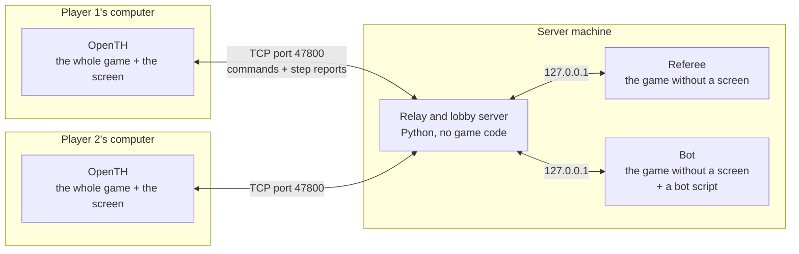
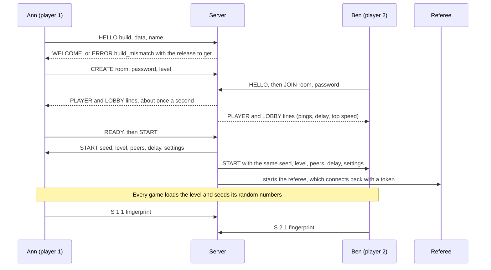
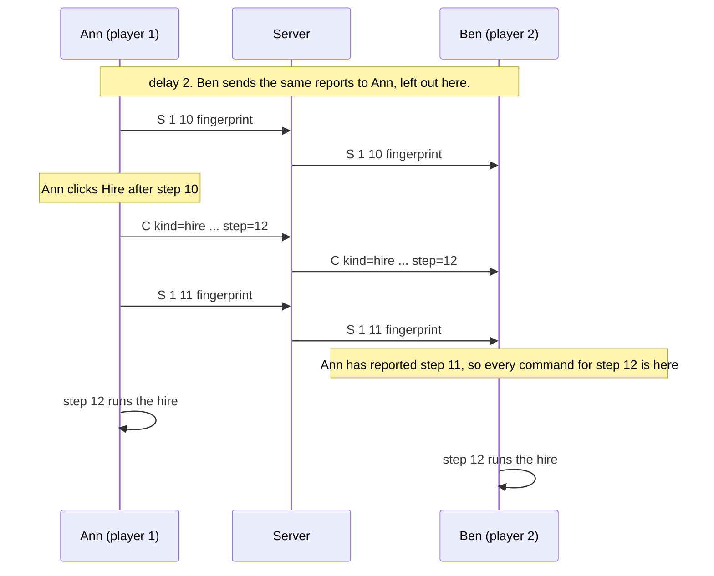
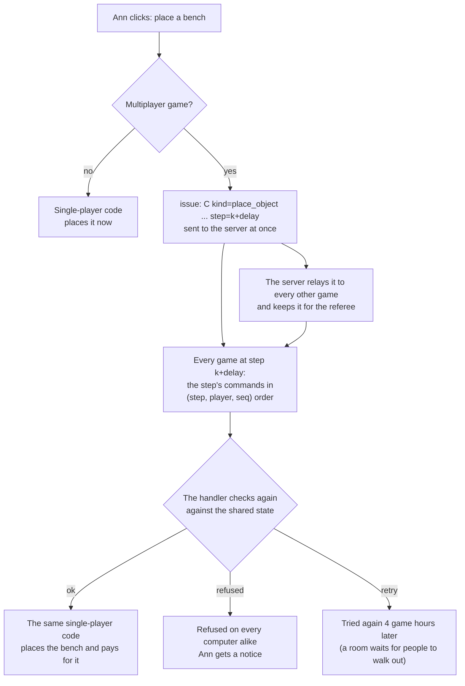
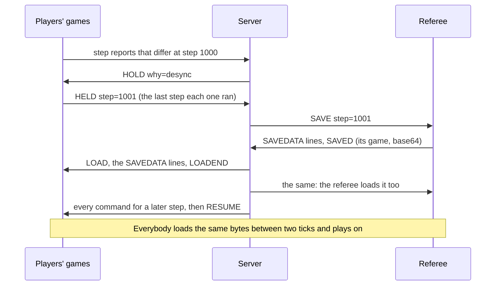
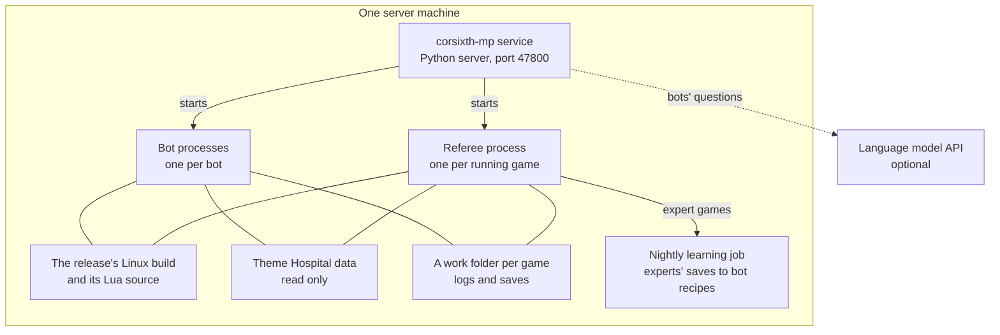

# How OpenTH works

A tour for programmers: what runs where, what travels over the network, and
why every player sees the same hospital. Written for build `8141203d`
(November 2026). The details of each part are in the files listed at the end.

## The short answer

Every player's computer runs the whole game: every hospital, every patient,
every rat. During a game the network carries only two kinds of line:

- **commands**: what a player did, such as "buy a bench at tile 40,61 facing
  north". A few per minute.
- **step reports**: "I have finished game hour 4321, and this is what my game
  looks like", in one short line (a fingerprint). About 18 a second at
  Normal speed.

Nothing else about the game is sent. No positions, no patients, no money, no
map. Each computer works all of that out by itself, from the same start and
the same commands, applied at the same game hour in the same order. This is
**deterministic lockstep**, the classic way real-time strategy games do
multiplayer.

So "a network connection that supplies additional input" is the right idea.
The hard part is not the connection. It is making several different computers
(Windows, Linux, macOS) compute the very same hospital, hour after hour, from
that input. Most of the multiplayer work went there.

## The pieces



| Piece | What it is | Code |
|---|---|---|
| The game | OpenTH: CorsixTH with the multiplayer code, all in Lua. Runs the full simulation and draws your view of it. | `CorsixTH/Lua/mp_session.lua` (lockstep, commands), `mp_lobby.lua` (server connection, lobby, start, repairs), `mp_transport.lua` (text lines over TCP, LuaSocket) |
| The server | A small Python (asyncio) program. Rooms and passwords, the build check, ping and pacing, the start of a game, relaying lines, comparing fingerprints, organising repairs. It never runs the game. | `mp_server/corsixth_mp/server.py`, `pacing.py`, `protocol.py` |
| The referee | One more copy of each running game, started by the server, without a screen. It checks the players and repairs their games. Optional. | `scripts/multiplayer/referee.lua`, `mp_server/corsixth_mp/referee.py` |
| Bots | Computer players. Each one is again the game without a screen, started by the server, playing one place through commands, like a person. | `scripts/multiplayer/bot.lua`, `bot_manager.lua` |

Everything multiplayer in the game is behind `TheApp.mp_session`. Without a
session the code paths are the original single-player ones. A test run of
three game years in single player (`scripts/multiplayer/run_sp_regression.sh`)
checks that a new build still plays single player exactly like the one
before it.

## The connection

- One TCP connection per player, to port 47800.
- Plain text, one message per line: a word, then `key=value` fields. Values
  are percent-encoded (`%`, `=` and spaces). Easy to read in a log.
- Ping every second in the lobby and every 2 seconds in a game. A connection
  that stays silent for 20 seconds is closed.
- Not encrypted in the current releases: room passwords and chat travel in
  clear text. A TLS layer (STARTTLS on the same port) is written and held
  back for now.

The full list of messages is in [protocol.md](protocol.md).

## From the lobby to the first step



The `START` line holds everything the games need to begin alike:

- the **seed** for the game's random numbers;
- the level and difficulty;
- each player's number (peer), name, colour and team, from which every game
  works out the same hospitals in the same places;
- the lockstep **delay** and the top speed (see below);
- the few gameplay settings that otherwise come from each player's own
  `config.txt` (such as `grant_wage_increase` and `free_build_mode`).

Before that the server checks two things in `HELLO`:

- **The build.** A checksum of all the game's Lua files, plus the Lua
  version, the save format and the protocol number. Different code would
  compute a different game, so a server with a referee turns away any build
  but its own and names the release to download.
- **The data.** A CRC-32 of the Theme Hospital level files. Editions of the
  game differ in them (multiplayer maps, level settings), and games with
  different files drift apart. On a server with a referee, a player with
  other data does not load the level from their own files: they get the
  referee's game instead. A server without a referee turns them away.

## Lockstep: the core

CorsixTH counts time in game hours (50 in a game day). Multiplayer cuts time
into **steps**. At Normal speed a step is one game hour and comes every 54 ms
(three ticks of the game's 18 ms timer); faster speeds make the steps shorter
(36 ms, 18 ms). At slower speeds and in pause a step still comes every 54 ms,
but the clock moves on only every few steps, so a click takes effect as
quickly at every speed.

The rules, from `mp_session.lua`:

1. A command a player issues after step *k* is for step ***k* + delay**. It
   is sent at once.
2. After running a step, every game sends `S <peer> <step> <fingerprint>`.
3. A game may run step *n* only when every other player has reported step
   ***n* − delay + 1**. Commands are sent before that report, and TCP keeps
   the lines in order, so by then every command for step *n* has arrived.
4. At the start of step *n*, every game runs that step's commands sorted by
   (step, player, sequence number), then advances the world.



The **delay** comes from the server: the smallest delay from 2 to 6 for which
a report crosses the server in time, (delay − 1) × step time ≥ the one-way
time between the players + 9 ms (`pacing.py`). With delay 2 a click shows up
2 × 54 = 108 ms later at Normal speed. The same rule sets the fastest speed a
room may choose.

Two real lines:

```
C hospital=2 kind=place_object object=bench orientation=north peer=2 seq=14 step=5123 x=40 y=61
S 2 201 1-01-05T01 bal=50000 visitors=0 entities=14 cured=0 staff=0 ecrc=6a4efe7a rng=6fbbe83b h2=49739/0/0/1 h3=50000/0/0/0
```

The fingerprint is the game date and hour, the first hospital's money,
visitors, cures and staff, the number of entities, a CRC of every entity's
kind and tile (`ecrc`), a CRC of the random number generator's state (`rng`),
and short totals of the other hospitals (`h2`, `h3`, ...). It is cheap to
make and catches almost any difference within a step or two.

What this feels like in play:

- Nobody gets more than `delay` steps ahead of anybody else. A slow computer,
  or a player with a window open that pauses their game (a fax, the annual
  report), holds everybody. After 0.7 s the others' screens turn blue, and
  after 1.5 s they read whom they wait for and why ("Waiting for Ben: a fax
  is open.").
- Pause and speed changes are commands too, so every game switches at the
  same step. A faster speed needs a majority vote, unless the room leaves
  the speed to its owner.

## What becomes a command

Every player action that changes the game: about 60 kinds. Building and
editing rooms, buying, moving and selling objects, hiring and firing, pay
rises, moving staff, prices, loans, research, policies, buying land and land
auctions, fax answers, trades between hospitals, speed and pause, saving,
and the dirty tricks of a race.

This plugs into the original code with little change. Where the user
interface would act, it first asks `MultiplayerSession.actionsAreCommands()`.
In a multiplayer game it issues a command instead. Later the command's
handler runs on every computer with `session.applying` set, and calls the
same single-player code that does the work.



The second check matters: two players may click on the same tile in the same
hour. Both commands arrive everywhere; the first in the sort order gets the
tile and the other is refused, on every computer alike.

## What never travels

- The camera, which hospital you are looking at, open windows, the cursor,
  sounds and music: each computer's own business.
- Chat. The server passes it on, but outside the lockstep.
- The outline of a room somebody is still drawing (a `SHOW` line, for the
  picture only). The room itself comes as one command when it is finished.
- The game's state. It travels in two cases only: a desync repair and a
  player joining a running game. Then a whole saved game goes over the wire
  (see below).

## The hard part: every computer must compute the same

Since only commands travel, any difference between two computers grows
silently, and the games drift apart. What had to change (the full list,
with stories, is in [README.md](README.md), "Lessons learned"):

1. **Random numbers.** Every game seeds the generator with the server's
   seed, and all gameplay randomness comes from it. What only one player
   sees (screen shake, which complaint a pay rise window shows, the wording
   of a staff description) draws from a second, cosmetic generator
   (`math.cosmetic_random`). One extra draw in one game changes everything
   after it. Every draw is logged with its step and source line, so a stray
   one can be found.
2. **Order.** Lua's `pairs()` visits a table in a different order in each
   process. Game code that decided something in `pairs()` order now uses a
   fixed order (buying a plot made its doors in `pairs()` order, for
   example).
3. **Platforms.** The game loads its definitions (rooms, diseases, objects) in
   directory listing order, which differs between NTFS and ext4. Multiplayer
   sorts them first. Every build uses the same Lua (5.5), and the build id
   includes the Lua version. Windows (MSVC), Linux (GCC) and macOS builds of
   one commit have the same build id.
4. **User interface that is really simulation.** A fax's timeout used to
   start when a door animation on screen finished; the annual report paid
   its awards when the player closed it. In multiplayer these run in game
   hours, at the same step everywhere.
5. **Local settings.** Options that change the rules come from the server at
   the start, not from each player's config.
6. **Translated names.** Commands name things by number and index, never by
   their text, so players with different languages play together.
7. **Errors.** A Lua error used to stop one game, and so everybody. Now an
   entity whose tick fails is set aside alike in every game, and the error
   goes to the server log.
8. **Numbers in saves.** A loaded game must equal one that was not saved and
   loaded: an integer stays an integer and a float a float (`50000` and
   `50000.0` print differently in a fingerprint).

## Catching and repairing a desync

The server compares the players' fingerprints for every step. When they
differ:

- **Without a referee** the server sends `DESYNC` and the game is over.
- **With a referee** the server repairs the games, and play goes on.

Each game also sends what it knows to the server log (money, rooms, every
entity, its last 2,000 random draws, each person's tile and action for the
last few steps), so the cause can be found afterwards
(`scripts/multiplayer/compare_draws.py`, `compare_states.py`).

### The referee

The referee is the game without a screen on the server machine, one for each
running game. The server starts it when the game starts; it connects to
`127.0.0.1` with a token, and the server replays to it every line it missed.
It plays the same game from the same commands, never issues one, and the
players never wait for it. It gives:

- **a second opinion**: when all players agree on a step, the server also
  compares them with the referee;
- **repairs**: its saved game is the one everybody loads;
- **joining a running game**, and a start for players with other game data.

A repair of everybody:



With three or more players there is a lighter repair: when most players agree
with each other and with the referee, only the others load the referee's game
(`REPAIRING`, `REPAIRED`) and the rest play on without a pause. When every
player agrees and only the referee differs, one player's game goes to the
referee.

## Bots

A bot is a separate game process without a screen, started by the server
when the room owner adds one. It joins like a person (`HELLO role=bot` with a
token) and takes a place. From then on it is just another player. It has its
own copy of the world and reads it directly (no screen reading), decides what
to do, and issues the same commands a person's clicks would. The other games
cannot tell a bot's command from a person's.

- A bot must not use the game's random numbers: a draw in the bot's game only
  would desync it. Its choices come from its own generator, and any game draw
  its code causes is undone.
- A bot can ask the server for advice from a small language model (Claude
  Haiku): once a game week it sends a report of its hospital and gets back
  priorities, and it can answer chat. The API key stays on the server; the
  bot still checks and does everything itself, and plays on its own rules
  when there is no advice. Optional, with a daily budget.
- Levels: easy, normal and hard. A hard bot gets hidden help (money and
  reputation each month). That help is part of the simulation, so every game
  applies it alike.
- A stand-in bot takes the place of a person who left, after 20 seconds,
  quietly, until somebody takes the place.
- The referee saves the games of chosen expert players; a nightly job turns
  them into room recipes and layouts the bots build from.

A bot or a referee costs about as much as a game without a screen: when it
was measured, about 80 MB and a few per cent of one CPU core each.

## Leaving, joining, saving

- **Leaving.** The server tells the others `LEFT` with the last step the
  player reported, and their games stop waiting for that player. This is safe:
  the player's commands were all sent before, for steps nobody has run yet.
- **Joining a running game** (with a referee). A newcomer takes a free place,
  a bot's place, or their own again. Everybody holds and loads the referee's
  game, the newcomer too.
- **Saving.** A save is a command (or the monthly autosave): every game saves
  after the same step, into its `Multiplayer` save folder. To continue, the
  host's game sends its save and everybody loads it, as in a repair.

## How much data

An estimate. A step report is 100 to 150 bytes, and at Normal a game sends
about 18 a second: 2 to 3 KB/s, plus TCP overhead. It receives the same from
each other player. Commands add a few lines of about 100 bytes a minute. A
whole saved game travels only for a repair, a join or a continued game
(compressed, base64, in lines of 48,000 characters).

## The servers

OpenTH's public servers (eu2 runs test builds, every other one the stable
release; https://openth.org/play lists them) each run:



One script sets it all up: `mp_server/deploy/setup-referee-host.sh --release
mp-test-<commit>` (see [SERVER-SETUP.md](SERVER-SETUP.md)). The referee must
run the same build as the players, which is why such a server lets in only
that build. A plain server without a referee works too (the Docker image, or
a LAN game, [mp_server/README.md](../../mp_server/README.md)): then a desync
ends the game and nobody can join a running one.

## Where to read the code

| To understand | Read |
|---|---|
| The lockstep rule, commands, fingerprints | `CorsixTH/Lua/mp_session.lua`: `issue`, `poll`, `canStep`, `beforeStep`, `afterStep`, `defaultFingerprint` |
| How steps drive game time | `CorsixTH/Lua/world.lua`: `World:_mpTick`, `_mpHoursForStep`, `_advanceHours` |
| One command from click to handler | `handlers.place_object` in `mp_session.lua`, and `UIPlaceObjects` in `dialogs/place_objects.lua` |
| The lobby, the start, repairs on the game's side | `CorsixTH/Lua/mp_lobby.lua` |
| The server | `mp_server/corsixth_mp/server.py`: `_game_line`, `_record_fingerprint`, `_start_recovery` |
| Delay and top speed | `mp_server/corsixth_mp/pacing.py` |
| Referee and bots | `scripts/multiplayer/referee.lua`, `bot.lua`, `bot_manager.lua` |
| Tests | `scripts/multiplayer/run_lobby_probe.sh` (real games through the lobby, with `MP_REFEREE=1` for repairs), `mp_server/tests/`, `CorsixTH/Luatest/spec/mp_*_spec.lua` |

## More

- [protocol.md](protocol.md): every message between the game and the server
- [referee.md](referee.md): the referee, repairs, joining, other game data
- [bots.md](bots.md): what the bots do and how they decide
- [coop-architecture.md](coop-architecture.md): several hospitals in one world
- [README.md](README.md): the developer handover and the lessons learned
- [PLAYING.md](PLAYING.md): the player's guide
